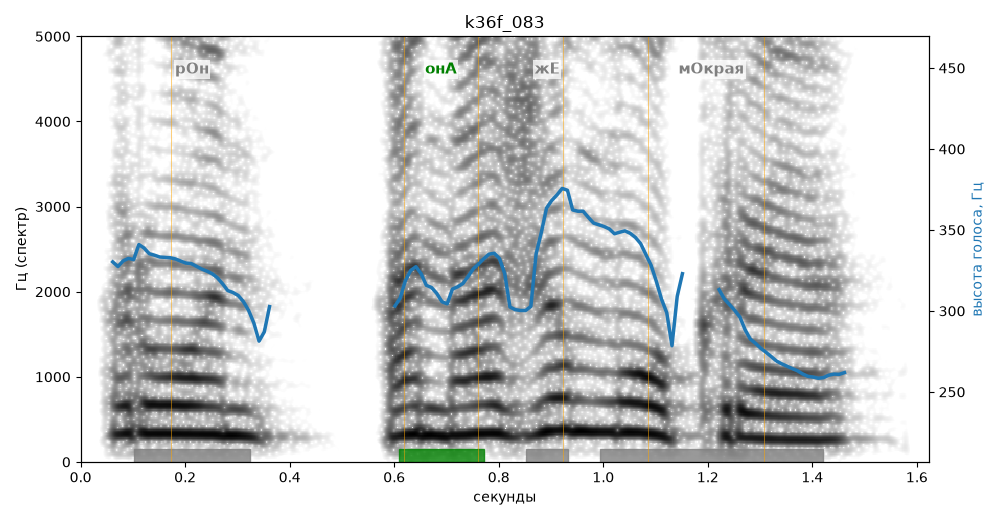

# k36f_083

Голос: **Филя, сборка 36e** · длительность 1.6 с
Эталон: Рон, она же мокрая!
Распознано: Рон, а нажимокре.
Расхождения в словах: «она же мокрая» → «а нажимокре»

## Ударения
(где нужно: ruaccent)

| слово | нужно | у голоса | |
|---|---|---|---|
| она | онА | онА | ✓ |
| мокрая | мОкрая | — | ? |

## Интонация
- ✗ «рон она же мокрая!» — восклицание звучит ровно, без эмоции
- Диапазон голоса 5.7 полутонов (нормально), средняя высота 320 Гц

## Паузы и темп
- паузы на своих местах
- Темп 5.8 слога/с (нормально)

_Синяя линия — высота голоса. Над словами заглавная буква — где ударение должно быть; красным — голос поставил не туда (уверенно), оранжевым — возможно._
