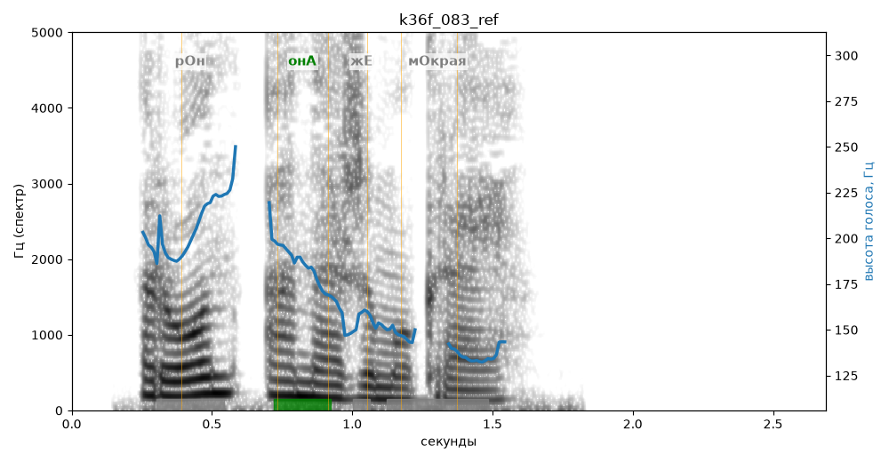

# k36f_083_ref

Голос: **edge:ru-RU-SvetlanaNeural** · длительность 2.7 с
Эталон: Рон, она же мо́края!
Распознано: Рон а нажимок Рай
Расхождения в словах: «она же мо края» → «а нажимок рай»

## Ударения
(где нужно: ruaccent)

| слово | нужно | у голоса | |
|---|---|---|---|
| она | онА | онА | ✓ |
| мокрая | мОкрая | — | ? |

## Интонация
- ✓ «рон она же мокрая!» — выделено слово «рон» (+3.5 пт)
- Диапазон голоса 8.9 полутонов (живо), средняя высота 170 Гц

## Паузы и темп
- паузы на своих местах
- Темп 6.0 слога/с (нормально)

_Синяя линия — высота голоса. Над словами заглавная буква — где ударение должно быть; красным — голос поставил не туда (уверенно), оранжевым — возможно._
