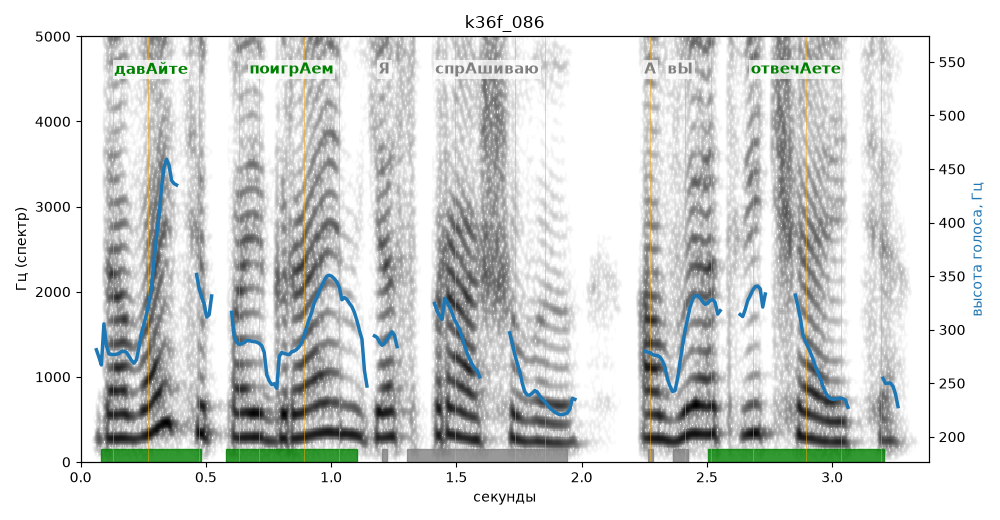

# k36f_086

Голос: **Филя, сборка 36e** · длительность 3.4 с
Эталон: Давайте поиграем! Я спрашиваю, а вы отвечаете.
Распознано: Давайте поиграем я спрашиваю, а вы отвечаете.
Слова: все совпали

## Ударения
(где нужно: ruaccent)

| слово | нужно | у голоса | |
|---|---|---|---|
| давайте | давАйте | давАйте | ✓ |
| поиграем | поигрАем | поигрАем | ✓ |
| спрашиваю | спрАшиваю | — | ? |
| отвечаете | отвечАете | отвечАете | ✓ |

## Интонация
- ✓ «давайте поиграем!» — выделено слово «давайте» (+2.8 пт)
- ✗ «я спрашиваю а вы отвечаете.» — конец фразы не понижается — звучит незаконченно / как перечисление
- Диапазон голоса 7.3 полутонов (живо), средняя высота 287 Гц

## Паузы и темп
- после «поиграем!» пауза всего 0.10 с — фразы слипаются
- Темп 6.1 слога/с (нормально)

_Синяя линия — высота голоса. Над словами заглавная буква — где ударение должно быть; красным — голос поставил не туда (уверенно), оранжевым — возможно._
