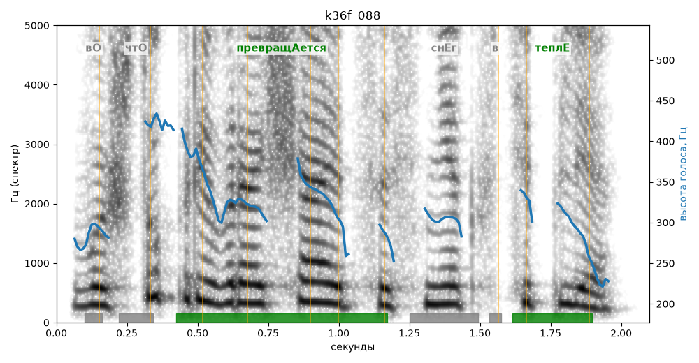

# k36f_088

Голос: **Филя, сборка 36e** · длительность 2.1 с
Эталон: Во что превращается снег в тепле?
Распознано: Вот что превращается снег в тепле.
Расхождения в словах: «во» → «вот»

## Ударения
(где нужно: ruaccent)

| слово | нужно | у голоса | |
|---|---|---|---|
| превращается | превращАется | превращАется | ✓ |
| тепле | теплЕ | теплЕ | ✓ |

## Интонация
- ✓ «во что превращается снег в тепле?» — конец фразы понижается — звучит законченно
- Диапазон голоса 8.9 полутонов (живо), средняя высота 313 Гц

## Паузы и темп
- паузы на своих местах
- Темп 6.1 слога/с (нормально)

_Синяя линия — высота голоса. Над словами заглавная буква — где ударение должно быть; красным — голос поставил не туда (уверенно), оранжевым — возможно._
