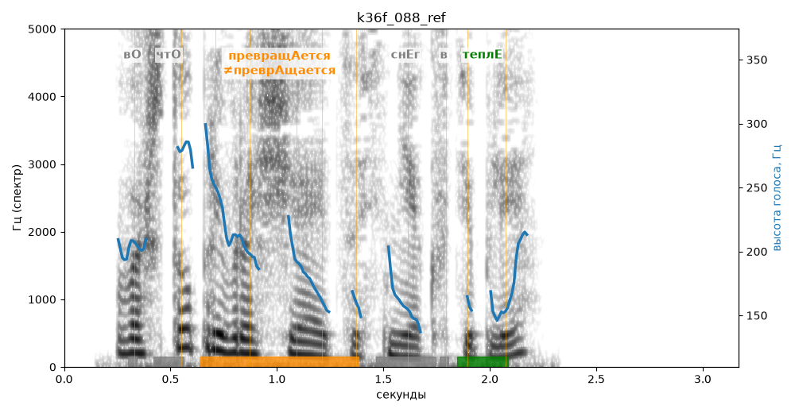

# k36f_088_ref

Голос: **edge:ru-RU-SvetlanaNeural** · длительность 3.2 с
Эталон: Во что превращается снег в тепле?
Распознано: Во что превращается снег в тепле?
Слова: все совпали

## Ударения
(где нужно: ruaccent)

| слово | нужно | у голоса | |
|---|---|---|---|
| превращается | превращАется | преврАщается | ✗? возможно — послушать |
| тепле | теплЕ | теплЕ | ✓ |

## Интонация
- ✓ «во что превращается снег в тепле?» — конец фразы понижается — звучит законченно
- Диапазон голоса 11.0 полутонов (живо), средняя высота 194 Гц

## Паузы и темп
- паузы на своих местах
- Темп 6.2 слога/с (нормально)

_Синяя линия — высота голоса. Над словами заглавная буква — где ударение должно быть; красным — голос поставил не туда (уверенно), оранжевым — возможно._
