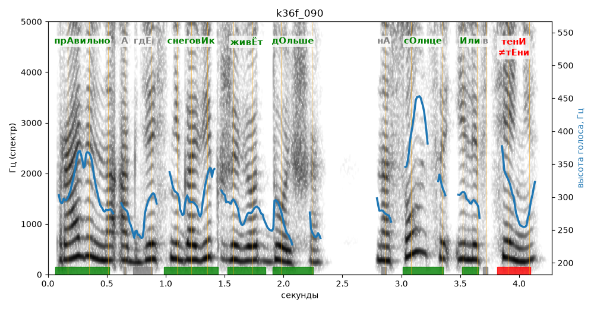

# k36f_090

Голос: **Филя, сборка 36e** · длительность 4.3 с
Эталон: Правильно! А где снеговик живёт дольше: на солнце или в тени?
Распознано: Правильно, а где снеговик живет дольше? На солнце или в тени?
Слова: все совпали

## Ударения
(где нужно: ruaccent)

| слово | нужно | у голоса | |
|---|---|---|---|
| правильно | прАвильно | прАвильно | ✓ |
| снеговик | снеговИк | снеговИк | ✓ |
| живёт | живЁт | живЁт | ✓ |
| дольше | дОльше | дОльше | ✓ |
| солнце | сОлнце | сОлнце | ✓ |
| или | Или | Или | ✓ |
| тени | тенИ | тЕни | ✗ ОШИБКА |

## Интонация
- ✗ «правильно!» — восклицание звучит ровно, без эмоции
- ✓ «а где снеговик живёт дольше на солнце или в тени?» — вопросительный подъём на слове «солнце»
- Диапазон голоса 8.1 полутонов (живо), средняя высота 291 Гц

## Паузы и темп
- после «правильно!» пауза всего 0.12 с — фразы слипаются
- Темп 6.1 слога/с (нормально)

_Синяя линия — высота голоса. Над словами заглавная буква — где ударение должно быть; красным — голос поставил не туда (уверенно), оранжевым — возможно._
