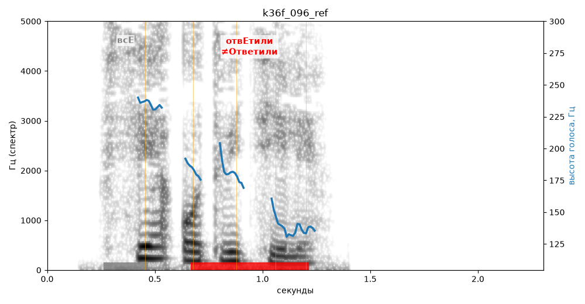

# k36f_096_ref

Голос: **edge:ru-RU-SvetlanaNeural** · длительность 2.3 с
Эталон: Все́ отве́тили!
Распознано: Все ответили.
Расхождения в словах: «отве тили» → «ответили»

## Ударения
(где нужно: дано в тексте)

| слово | нужно | у голоса | |
|---|---|---|---|
| ответили | отвЕтили | Ответили | ✗ ОШИБКА |

## Интонация
- ✓ «все ответили!» — выделено слово «все» (+4.6 пт)
- Диапазон голоса 10.1 полутонов (живо), средняя высота 178 Гц

## Паузы и темп
- паузы на своих местах
- Темп 6.7 слога/с (быстро)

_Синяя линия — высота голоса. Над словами заглавная буква — где ударение должно быть; красным — голос поставил не туда (уверенно), оранжевым — возможно._
