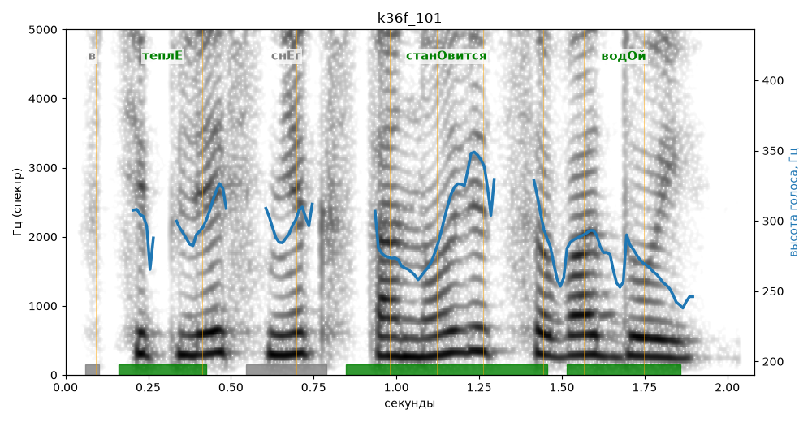

# k36f_101

Голос: **Филя, сборка 36e** · длительность 2.1 с
Эталон: В тепле снег становится водой
Распознано: В тепле снег становится водой.
Слова: все совпали

## Ударения
(где нужно: ruaccent)

| слово | нужно | у голоса | |
|---|---|---|---|
| тепле | теплЕ | теплЕ | ✓ |
| становится | станОвится | станОвится | ✓ |
| водой | водОй | водОй | ✓ |

## Интонация
- ✓ «в тепле снег становится водой» — конец фразы понижается — звучит законченно
- Диапазон голоса 4.9 полутонов (нормально), средняя высота 287 Гц

## Паузы и темп
- паузы на своих местах
- Темп 5.6 слога/с (нормально)

_Синяя линия — высота голоса. Над словами заглавная буква — где ударение должно быть; красным — голос поставил не туда (уверенно), оранжевым — возможно._
