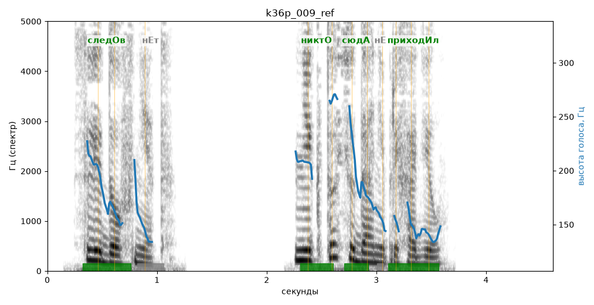

# k36p_009_ref

Голос: **edge:ru-RU-SvetlanaNeural** · длительность 4.6 с
Эталон: Следов нет. Никто сюда не приходил.
Распознано: Следов нет. Никто сюда не приходил.
Слова: все совпали

## Ударения
(где нужно: ruaccent)

| слово | нужно | у голоса | |
|---|---|---|---|
| следов | следОв | следОв | ✓ |
| никто | никтО | никтО | ✓ |
| сюда | сюдА | сюдА | ✓ |
| приходил | приходИл | приходИл | ✓ |

## Интонация
- ✓ «следов нет.» — конец фразы понижается — звучит законченно
- ✓ «никто сюда не приходил.» — конец фразы понижается — звучит законченно
- Диапазон голоса 11.4 полутонов (живо), средняя высота 166 Гц

## Паузы и темп
- паузы на своих местах
- Темп 5.5 слога/с (нормально)

_Синяя линия — высота голоса. Над словами заглавная буква — где ударение должно быть; красным — голос поставил не туда (уверенно), оранжевым — возможно._
