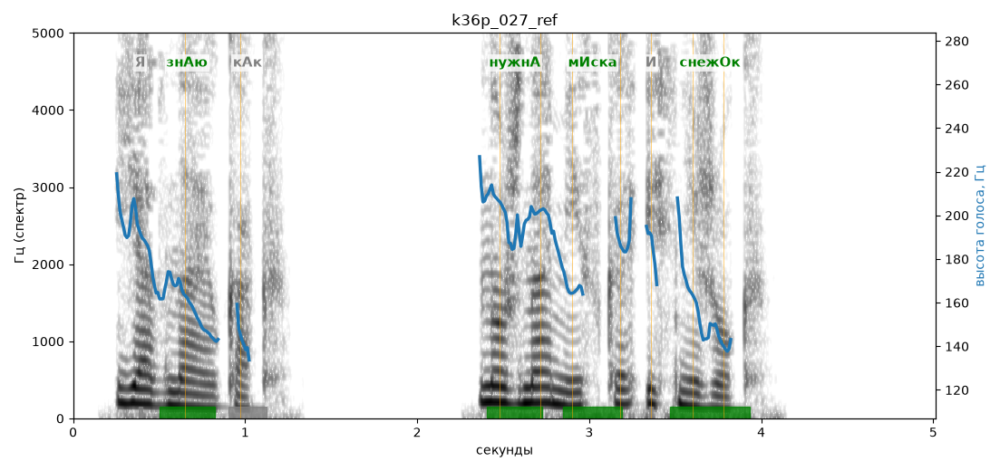

# k36p_027_ref

Голос: **edge:ru-RU-SvetlanaNeural** · длительность 5.0 с
Эталон: Я знаю как. Нужна миска и снежок.
Распознано: Я знаю как. Нужна миска и снежок.
Слова: все совпали

## Ударения
(где нужно: ruaccent)

| слово | нужно | у голоса | |
|---|---|---|---|
| знаю | знАю | знАю | ✓ |
| нужна | нужнА | нужнА | ✓ |
| миска | мИска | мИска | ✓ |
| снежок | снежОк | снежОк | ✓ |

## Интонация
- ✓ «нужна миска и снежок.» — конец фразы понижается — звучит законченно
- Диапазон голоса 6.7 полутонов (нормально), средняя высота 176 Гц

## Паузы и темп
- паузы на своих местах
- Темп 4.3 слога/с (нормально)

_Синяя линия — высота голоса. Над словами заглавная буква — где ударение должно быть; красным — голос поставил не туда (уверенно), оранжевым — возможно._
