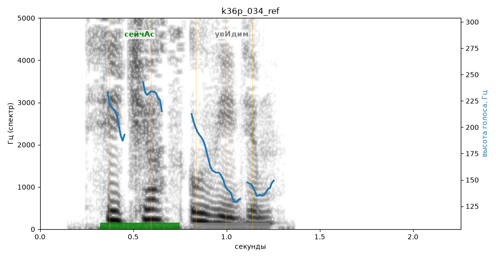

# k36p_034_ref

Голос: **edge:ru-RU-SvetlanaNeural** · длительность 2.3 с
Эталон: Сейчас увидим.
Распознано: Сейчас увидим.
Слова: все совпали

## Ударения
(где нужно: ruaccent)

| слово | нужно | у голоса | |
|---|---|---|---|
| сейчас | сейчАс | сейчАс | ✓ |
| увидим | увИдим | Увидим | ? не разобрать |

## Интонация
- ✓ «сейчас увидим.» — конец фразы понижается — звучит законченно
- Диапазон голоса 9.9 полутонов (живо), средняя высота 163 Гц

## Паузы и темп
- паузы на своих местах
- Темп 5.5 слога/с (нормально)

_Синяя линия — высота голоса. Над словами заглавная буква — где ударение должно быть; красным — голос поставил не туда (уверенно), оранжевым — возможно._
