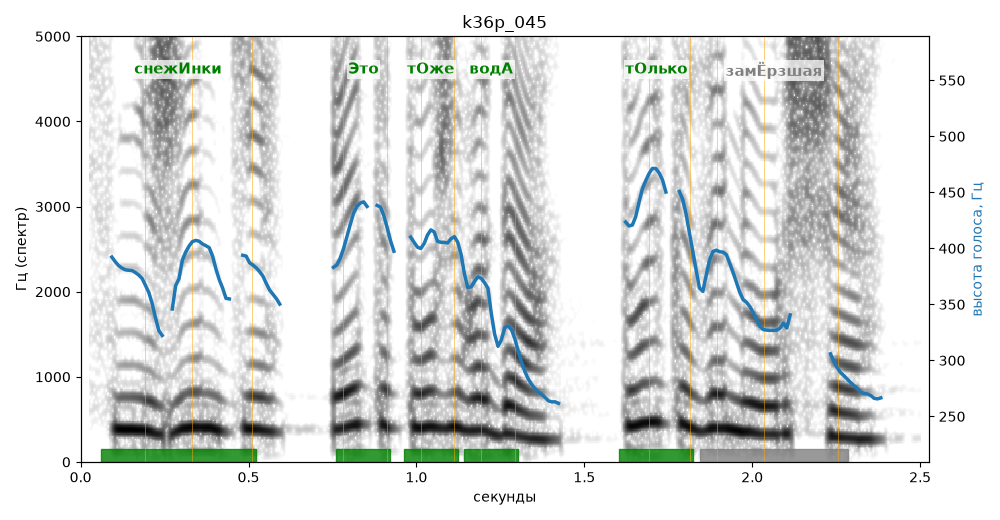

# k36p_045

Голос: **Пик, сборка 36e** · длительность 2.5 с
Эталон: Снежинки — это тоже вода. Только замёрзшая.
Распознано: Снижинки, это тоже вода, только вонорше.
Расхождения в словах: «снежинки» → «снижинки»; «замерзшая» → «вонорше»

## Ударения
(где нужно: ruaccent)

| слово | нужно | у голоса | |
|---|---|---|---|
| снежинки | снежИнки | снежИнки | ✓ |
| это | Это | Это | ✓ |
| тоже | тОже | тОже | ✓ |
| вода | водА | водА | ✓ |
| только | тОлько | тОлько | ✓ |
| замёрзшая | замЁрзшая | — | ? |

## Интонация
- ✓ «снежинки это тоже вода.» — конец фразы понижается — звучит законченно
- ✓ «только замёрзшая.» — конец фразы понижается — звучит законченно
- Диапазон голоса 8.8 полутонов (живо), средняя высота 377 Гц

## Паузы и темп
- паузы на своих местах
- Темп 8.3 слога/с (быстро)

_Синяя линия — высота голоса. Над словами заглавная буква — где ударение должно быть; красным — голос поставил не туда (уверенно), оранжевым — возможно._
