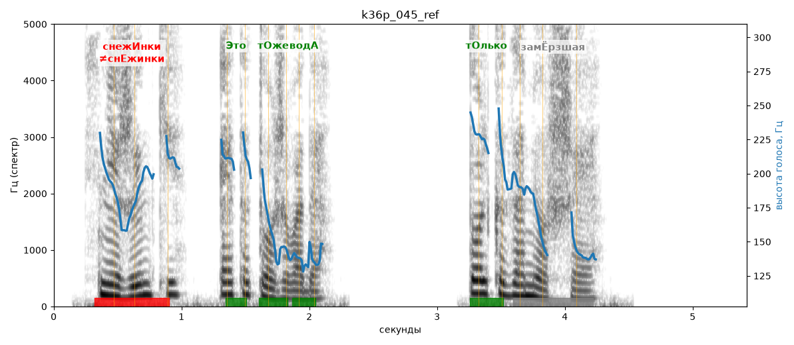

# k36p_045_ref

Голос: **edge:ru-RU-SvetlanaNeural** · длительность 5.4 с
Эталон: Снежинки — это тоже вода. Только замёрзшая.
Распознано: Снежинки, это тоже вода. Только замершие.
Расхождения в словах: «замерзшая» → «замершие»

## Ударения
(где нужно: ruaccent)

| слово | нужно | у голоса | |
|---|---|---|---|
| снежинки | снежИнки | снЕжинки | ✗ ОШИБКА |
| это | Это | Это | ✓ |
| тоже | тОже | тОже | ✓ |
| вода | водА | водА | ✓ |
| только | тОлько | тОлько | ✓ |
| замёрзшая | замЁрзшая | — | ? |

## Интонация
- ✓ «снежинки это тоже вода.» — конец фразы понижается — звучит законченно
- ✓ «только замёрзшая.» — конец фразы понижается — звучит законченно
- Диапазон голоса 9.2 полутонов (живо), средняя высота 185 Гц

## Паузы и темп
- паузы на своих местах
- Темп 6.2 слога/с (нормально)

_Синяя линия — высота голоса. Над словами заглавная буква — где ударение должно быть; красным — голос поставил не туда (уверенно), оранжевым — возможно._
