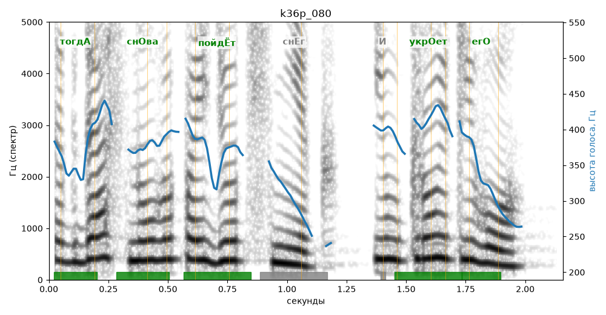

# k36p_080

Голос: **Пик, сборка 36e** · длительность 2.2 с
Эталон: Тогда снова пойдёт снег. И укроет его.
Распознано: Тогда снова пойдет снег, и укрой его.
Расхождения в словах: «укроет» → «укрой»

## Ударения
(где нужно: ruaccent)

| слово | нужно | у голоса | |
|---|---|---|---|
| тогда | тогдА | тогдА | ✓ |
| снова | снОва | снОва | ✓ |
| пойдёт | пойдЁт | пойдЁт | ✓ |
| укроет | укрОет | укрОет | ✓ |
| его | егО | егО | ✓ |

## Интонация
- ✓ «тогда снова пойдёт снег.» — конец фразы понижается — звучит законченно
- ✓ «и укроет его.» — конец фразы понижается — звучит законченно
- Диапазон голоса 8.2 полутонов (живо), средняя высота 375 Гц

## Паузы и темп
- паузы на своих местах
- Темп 7.9 слога/с (быстро)

_Синяя линия — высота голоса. Над словами заглавная буква — где ударение должно быть; красным — голос поставил не туда (уверенно), оранжевым — возможно._
