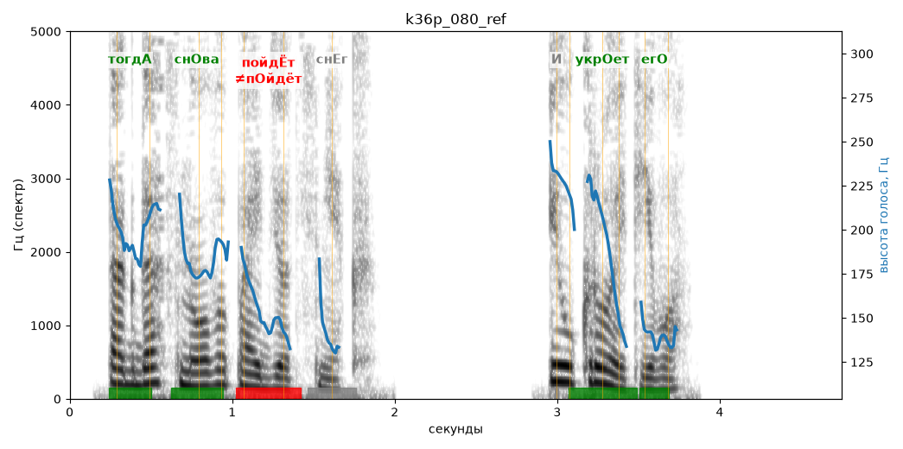

# k36p_080_ref

Голос: **edge:ru-RU-SvetlanaNeural** · длительность 4.8 с
Эталон: Тогда снова пойдёт снег. И укроет его.
Распознано: тогда снова пойдет снег. и укройте его.
Расхождения в словах: «укроет» → «укройте»

## Ударения
(где нужно: ruaccent)

| слово | нужно | у голоса | |
|---|---|---|---|
| тогда | тогдА | тогдА | ✓ |
| снова | снОва | снОва | ✓ |
| пойдёт | пойдЁт | пОйдёт | ✗ ОШИБКА |
| укроет | укрОет | укрОет | ✓ |
| его | егО | егО | ✓ |

## Интонация
- ✓ «тогда снова пойдёт снег.» — конец фразы понижается — звучит законченно
- ✓ «и укроет его.» — конец фразы понижается — звучит законченно
- Диапазон голоса 9.3 полутонов (живо), средняя высота 177 Гц

## Паузы и темп
- паузы на своих местах
- Темп 5.8 слога/с (нормально)

_Синяя линия — высота голоса. Над словами заглавная буква — где ударение должно быть; красным — голос поставил не туда (уверенно), оранжевым — возможно._
