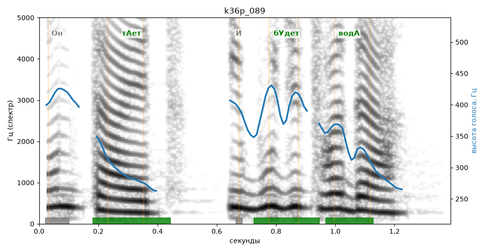

# k36p_089

Голос: **Пик, сборка 36e** · длительность 1.4 с
Эталон: Он тает. И будет вода!
Распознано: Онает и будет friend
Расхождения в словах: «он тает» → «онает»; «вода» → «»

## Ударения
(где нужно: ruaccent)

| слово | нужно | у голоса | |
|---|---|---|---|
| тает | тАет | тАет | ✓ |
| будет | бУдет | бУдет | ✓ |
| вода | водА | водА | ✓ |

## Интонация
- ✗ «он тает.» — конец фразы не понижается — звучит незаконченно / как перечисление
- ✗ «и будет вода!» — восклицание звучит ровно, без эмоции
- Диапазон голоса 8.0 полутонов (живо), средняя высота 355 Гц

## Паузы и темп
- паузы на своих местах
- Темп 9.0 слога/с (быстро)

_Синяя линия — высота голоса. Над словами заглавная буква — где ударение должно быть; красным — голос поставил не туда (уверенно), оранжевым — возможно._
