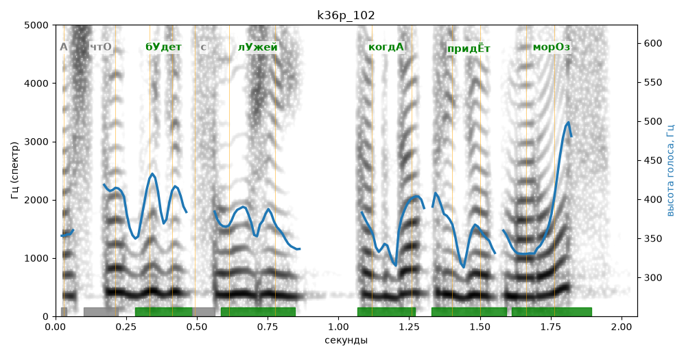

# k36p_102

Голос: **Пик, сборка 36e** · длительность 2.1 с
Эталон: А что будет с лужей, когда придёт мороз?
Распознано: А что будет сужий, когда придёт Мороз?
Расхождения в словах: «с лужей» → «сужий»

## Ударения
(где нужно: ruaccent)

| слово | нужно | у голоса | |
|---|---|---|---|
| будет | бУдет | бУдет | ✓ |
| лужей | лУжей | лУжей | ✓ |
| когда | когдА | когдА | ✓ |
| придёт | придЁт | придЁт | ✓ |
| мороз | морОз | морОз | ✓ |

## Интонация
- ✓ «а что будет с лужей когда придёт мороз?» — вопросительный подъём на слове «мороз»
- Диапазон голоса 4.5 полутонов (нормально), средняя высота 368 Гц

## Паузы и темп
- паузы на своих местах
- Темп 7.9 слога/с (быстро)

_Синяя линия — высота голоса. Над словами заглавная буква — где ударение должно быть; красным — голос поставил не туда (уверенно), оранжевым — возможно._
