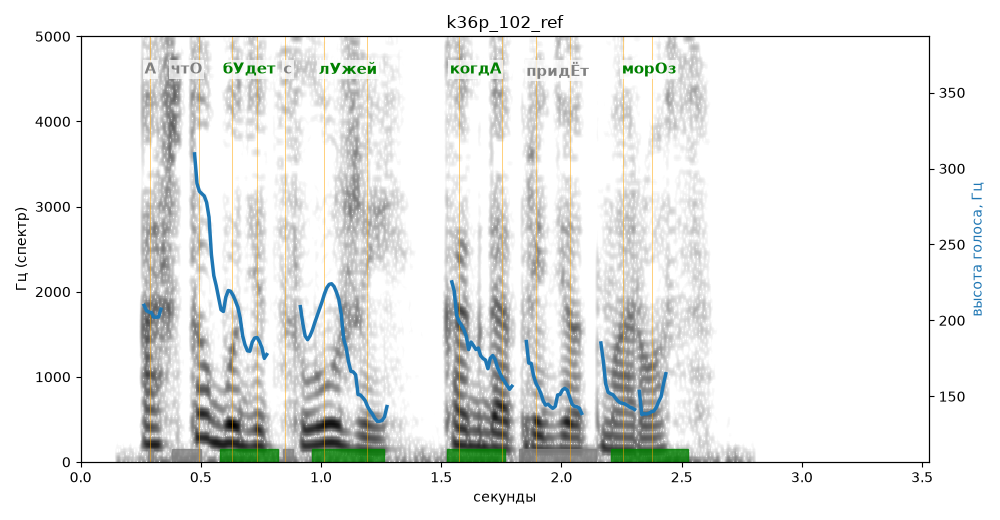

# k36p_102_ref

Голос: **edge:ru-RU-SvetlanaNeural** · длительность 3.5 с
Эталон: А что будет с лужей, когда придёт мороз?
Распознано: А что будет служий, когда придет мороз?
Расхождения в словах: «с лужей» → «служий»

## Ударения
(где нужно: ruaccent)

| слово | нужно | у голоса | |
|---|---|---|---|
| будет | бУдет | бУдет | ✓ |
| лужей | лУжей | лУжей | ✓ |
| когда | когдА | когдА | ✓ |
| придёт | придЁт | прИдёт | ? не разобрать |
| мороз | морОз | морОз | ✓ |

## Интонация
- ✓ «а что будет с лужей когда придёт мороз?» — вопросительный подъём на слове «что»
- Диапазон голоса 9.1 полутонов (живо), средняя высота 175 Гц

## Паузы и темп
- паузы на своих местах
- Темп 6.6 слога/с (быстро)

_Синяя линия — высота голоса. Над словами заглавная буква — где ударение должно быть; красным — голос поставил не туда (уверенно), оранжевым — возможно._
