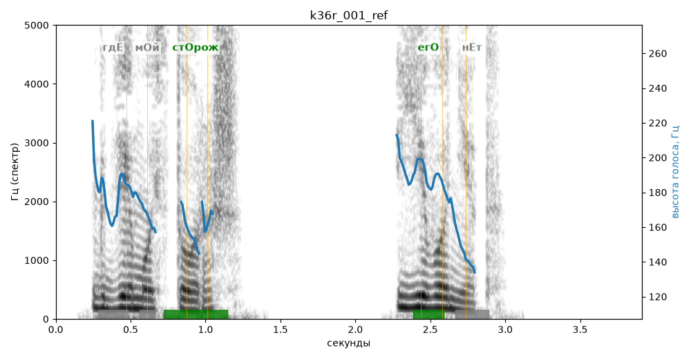

# k36r_001_ref

Голос: **edge:ru-RU-SvetlanaNeural** · длительность 3.9 с
Эталон: Где мой сторож? Его нет!
Распознано: Где мой сторож? Его нет.
Слова: все совпали

## Ударения
(где нужно: ruaccent)

| слово | нужно | у голоса | |
|---|---|---|---|
| сторож | стОрож | стОрож | ✓ |
| его | егО | егО | ✓ |

## Интонация
- ✓ «где мой сторож?» — конец фразы понижается — звучит законченно
- ✗ «его нет!» — восклицание звучит ровно, без эмоции
- Диапазон голоса 5.9 полутонов (нормально), средняя высота 176 Гц

## Паузы и темп
- паузы на своих местах
- Темп 5.1 слога/с (нормально)

_Синяя линия — высота голоса. Над словами заглавная буква — где ударение должно быть; красным — голос поставил не туда (уверенно), оранжевым — возможно._
