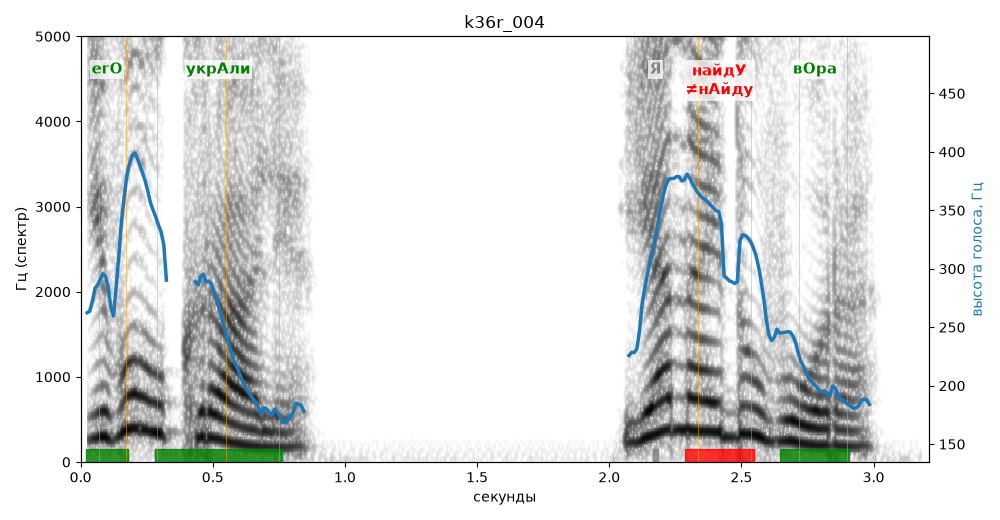

# k36r_004

Голос: **Рон, сборка 36e** · длительность 3.2 с
Эталон: Его украли! Я найду вора!
Распознано: Его украли. Я найду вора.
Слова: все совпали

## Ударения
(где нужно: ruaccent)

| слово | нужно | у голоса | |
|---|---|---|---|
| его | егО | егО | ✓ |
| украли | укрАли | укрАли | ✓ |
| найду | найдУ | нАйду | ✗ ОШИБКА |
| вора | вОра | вОра | ✓ |

## Интонация
- ✓ «его украли!» — выделено слово «его» (+5.0 пт)
- ✓ «я найду вора!» — выделено слово «найду» (+2.2 пт)
- Диапазон голоса 13.2 полутонов (живо), средняя высота 270 Гц

## Паузы и темп
- паузы на своих местах
- Темп 6.1 слога/с (нормально)

_Синяя линия — высота голоса. Над словами заглавная буква — где ударение должно быть; красным — голос поставил не туда (уверенно), оранжевым — возможно._
