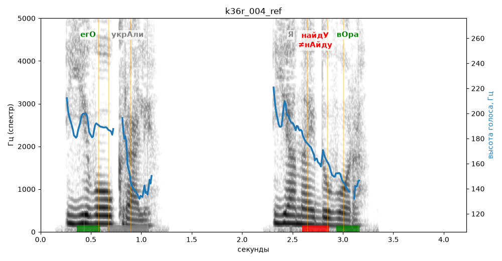

# k36r_004_ref

Голос: **edge:ru-RU-SvetlanaNeural** · длительность 4.2 с
Эталон: Его украли! Я найду вора!
Распознано: Его украли. Я найду вора.
Слова: все совпали

## Ударения
(где нужно: ruaccent)

| слово | нужно | у голоса | |
|---|---|---|---|
| его | егО | егО | ✓ |
| украли | укрАли | Украли | ? не разобрать |
| найду | найдУ | нАйду | ✗ ОШИБКА |
| вора | вОра | вОра | ✓ |

## Интонация
- ✗ «его украли!» — восклицание звучит ровно, без эмоции
- ✗ «я найду вора!» — восклицание звучит ровно, без эмоции
- Диапазон голоса 6.6 полутонов (нормально), средняя высота 181 Гц

## Паузы и темп
- паузы на своих местах
- Темп 6.5 слога/с (нормально)

_Синяя линия — высота голоса. Над словами заглавная буква — где ударение должно быть; красным — голос поставил не туда (уверенно), оранжевым — возможно._
