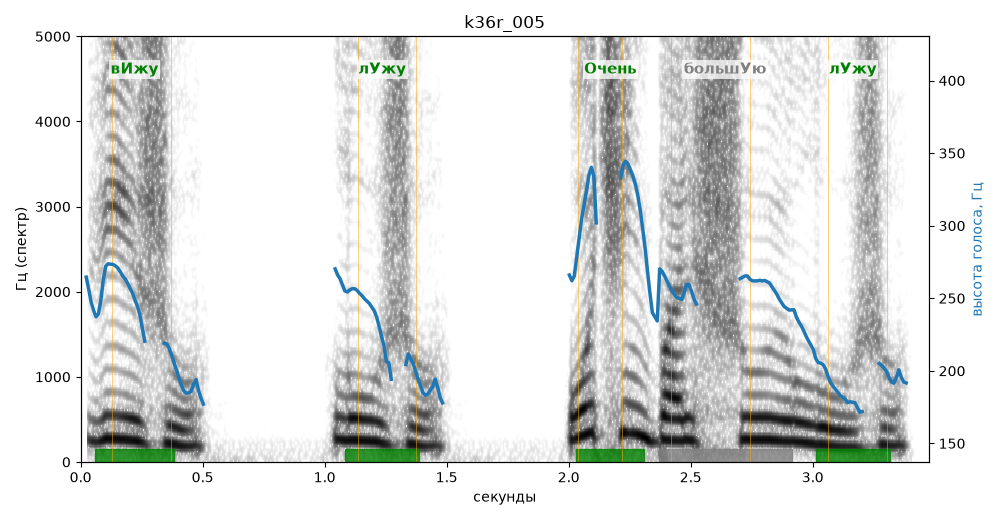

# k36r_005

Голос: **Рон, сборка 36e** · длительность 3.5 с
Эталон: Вижу… лужу. Очень большую лужу.
Распознано: вижу, лужу, очень большую лужу.
Слова: все совпали

## Ударения
(где нужно: ruaccent)

| слово | нужно | у голоса | |
|---|---|---|---|
| вижу | вИжу | вИжу | ✓ |
| лужу | лУжу | лУжу | ✓ |
| очень | Очень | Очень | ✓ |
| большую | большУю | — | ? |
| лужу | лУжу | лУжу | ✓ |

## Интонация
- ✓ «очень большую лужу.» — конец фразы понижается — звучит законченно
- Диапазон голоса 10.2 полутонов (живо), средняя высота 244 Гц

## Паузы и темп
- паузы на своих местах
- Темп 5.2 слога/с (нормально)

_Синяя линия — высота голоса. Над словами заглавная буква — где ударение должно быть; красным — голос поставил не туда (уверенно), оранжевым — возможно._
