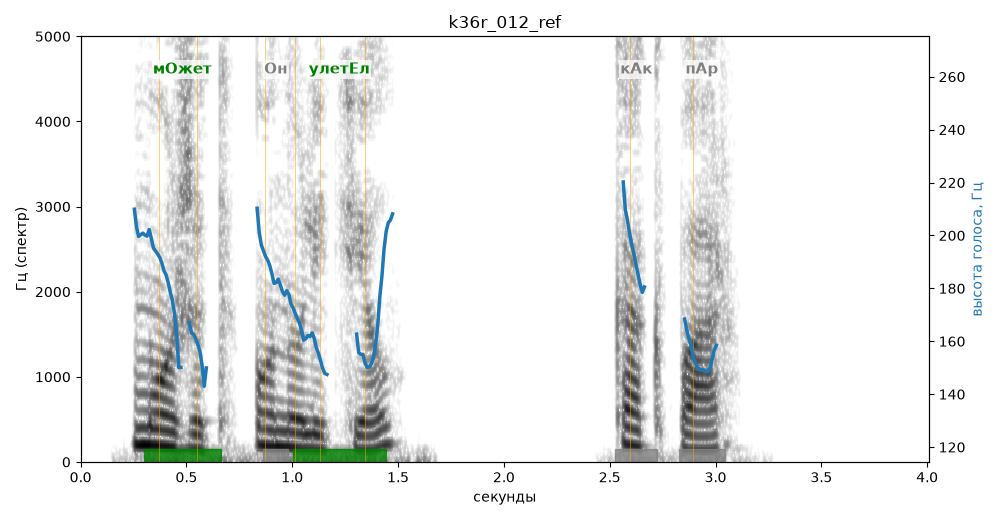

# k36r_012_ref

Голос: **edge:ru-RU-SvetlanaNeural** · длительность 4.0 с
Эталон: Может, он улетел? Как пар?
Распознано: Может он улетел? Как пар?
Слова: все совпали

## Ударения
(где нужно: ruaccent)

| слово | нужно | у голоса | |
|---|---|---|---|
| может | мОжет | мОжет | ✓ |
| улетел | улетЕл | улетЕл | ✓ |

## Интонация
- ✗ «может он улетел?» — нет вопросительного подъёма (самое высокое место — «может», в начале) — звучит как утверждение
- Диапазон голоса 5.6 полутонов (нормально), средняя высота 171 Гц

## Паузы и темп
- паузы на своих местах
- Темп 5.5 слога/с (нормально)

_Синяя линия — высота голоса. Над словами заглавная буква — где ударение должно быть; красным — голос поставил не туда (уверенно), оранжевым — возможно._
