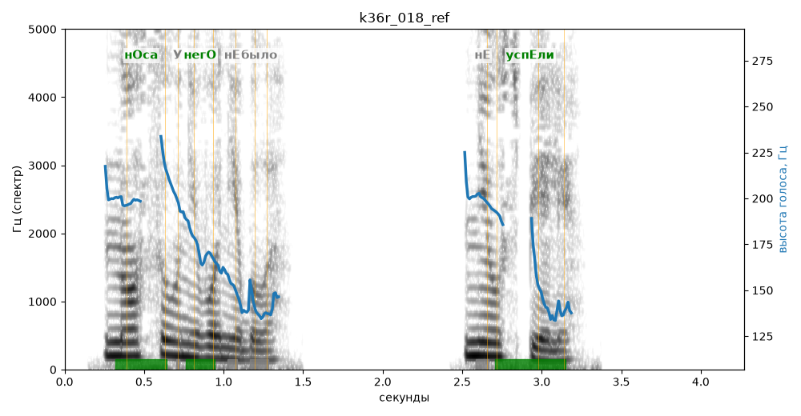

# k36r_018_ref

Голос: **edge:ru-RU-SvetlanaNeural** · длительность 4.3 с
Эталон: Носа у него не было. Не успели.
Распознано: Но с у него не было. Не успели.
Расхождения в словах: «носа» → «но с»

## Ударения
(где нужно: ruaccent)

| слово | нужно | у голоса | |
|---|---|---|---|
| носа | нОса | нОса | ✓ |
| него | негО | негО | ✓ |
| было | было | бЫло | нет эталона |
| успели | успЕли | успЕли | ✓ |

## Интонация
- ✓ «носа у него не было.» — конец фразы понижается — звучит законченно
- ✓ «не успели.» — конец фразы понижается — звучит законченно
- Диапазон голоса 7.5 полутонов (живо), средняя высота 171 Гц

## Паузы и темп
- паузы на своих местах
- Темп 7.9 слога/с (быстро)

_Синяя линия — высота голоса. Над словами заглавная буква — где ударение должно быть; красным — голос поставил не туда (уверенно), оранжевым — возможно._
