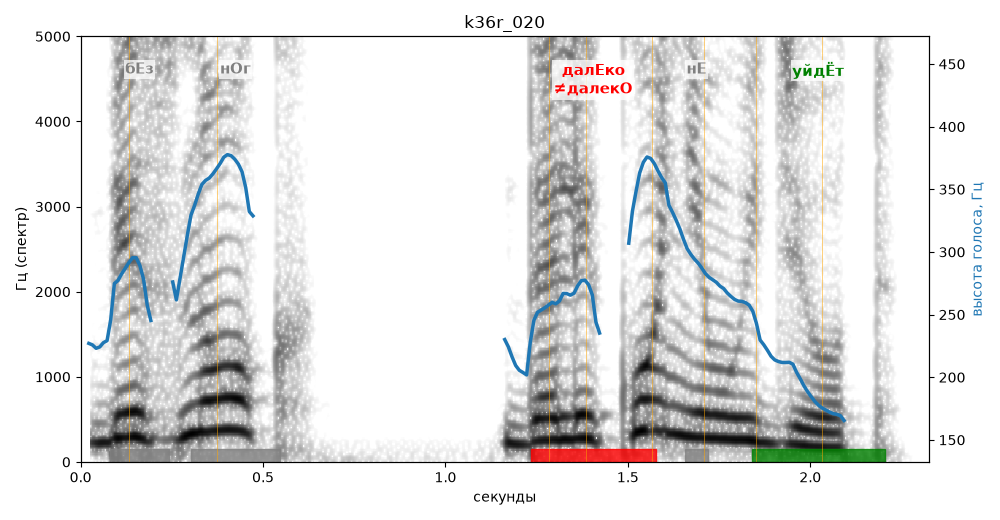

# k36r_020

Голос: **Рон, сборка 36e** · длительность 2.3 с
Эталон: Без ног? Далеко не уйдёт.
Распознано: без ног, далеко не уйдет.
Слова: все совпали

## Ударения
(где нужно: ruaccent)

| слово | нужно | у голоса | |
|---|---|---|---|
| далеко | далЕко | далекО | ✗ ОШИБКА |
| уйдёт | уйдЁт | уйдЁт | ✓ |

## Интонация
- ✓ «далеко не уйдёт.» — конец фразы понижается — звучит законченно
- Диапазон голоса 12.9 полутонов (живо), средняя высота 267 Гц

## Паузы и темп
- паузы на своих местах
- Темп 5.6 слога/с (нормально)

_Синяя линия — высота голоса. Над словами заглавная буква — где ударение должно быть; красным — голос поставил не туда (уверенно), оранжевым — возможно._
