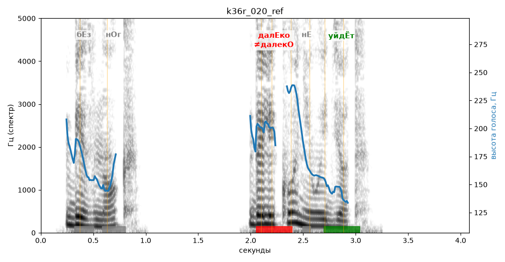

# k36r_020_ref

Голос: **edge:ru-RU-SvetlanaNeural** · длительность 4.1 с
Эталон: Без ног? Далеко не уйдёт.
Распознано: без ног далеко не уйдет
Слова: все совпали

## Ударения
(где нужно: ruaccent)

| слово | нужно | у голоса | |
|---|---|---|---|
| далеко | далЕко | далекО | ✗ ОШИБКА |
| уйдёт | уйдЁт | уйдЁт | ✓ |

## Интонация
- ✓ «далеко не уйдёт.» — конец фразы понижается — звучит законченно
- Диапазон голоса 8.6 полутонов (живо), средняя высота 166 Гц

## Паузы и темп
- паузы на своих местах
- Темп 5.5 слога/с (нормально)

_Синяя линия — высота голоса. Над словами заглавная буква — где ударение должно быть; красным — голос поставил не туда (уверенно), оранжевым — возможно._
