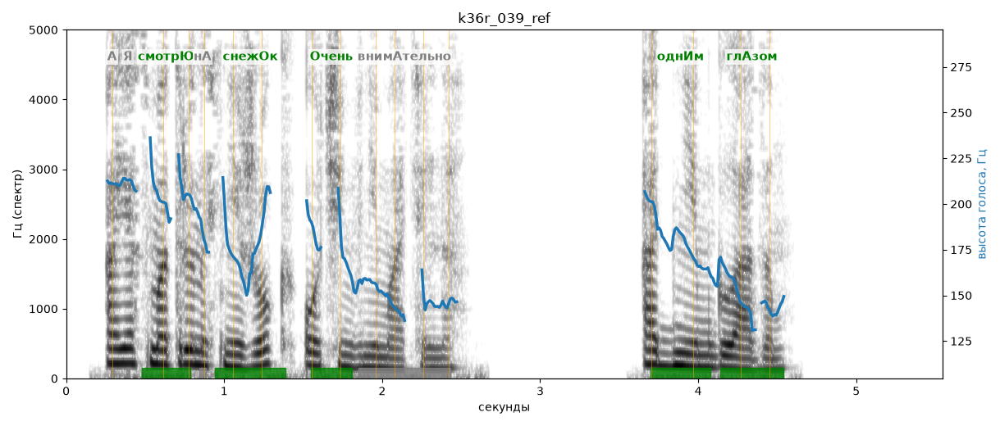

# k36r_039_ref

Голос: **edge:ru-RU-SvetlanaNeural** · длительность 5.5 с
Эталон: А я смотрю на снежок очень внимательно. Одним глазом.
Распознано: А я смотрю на снежок очень внимательно. Одним глазом.
Слова: все совпали

## Ударения
(где нужно: ruaccent)

| слово | нужно | у голоса | |
|---|---|---|---|
| смотрю | смотрЮ | смотрЮ | ✓ |
| снежок | снежОк | снежОк | ✓ |
| очень | Очень | Очень | ✓ |
| внимательно | внимАтельно | внИмательно | ? не разобрать |
| одним | однИм | однИм | ✓ |
| глазом | глАзом | глАзом | ✓ |

## Интонация
- ✓ «а я смотрю на снежок очень внимательно.» — конец фразы понижается — звучит законченно
- ✓ «одним глазом.» — конец фразы понижается — звучит законченно
- Диапазон голоса 7.1 полутонов (живо), средняя высота 169 Гц

## Паузы и темп
- паузы на своих местах
- Темп 5.6 слога/с (нормально)

_Синяя линия — высота голоса. Над словами заглавная буква — где ударение должно быть; красным — голос поставил не туда (уверенно), оранжевым — возможно._
