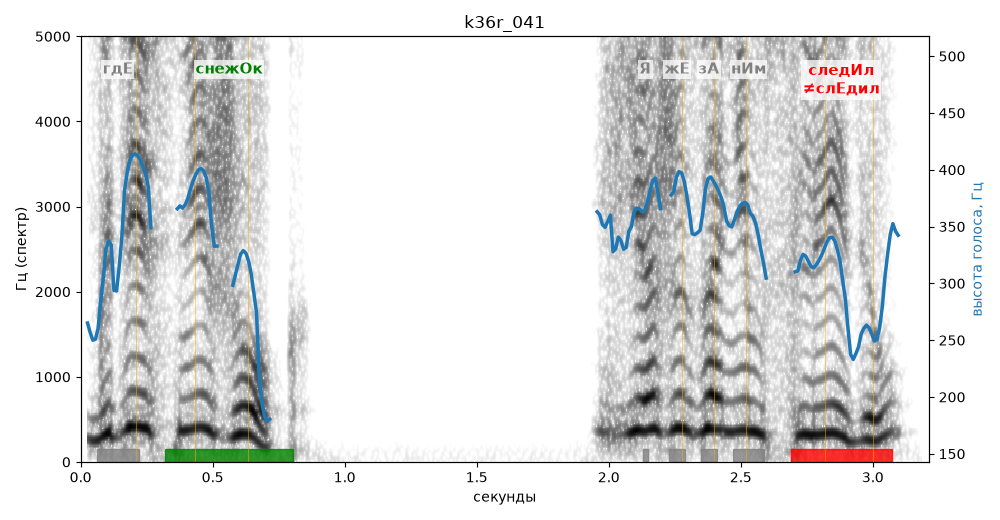

# k36r_041

Голос: **Рон, сборка 36e** · длительность 3.2 с
Эталон: Где снежок? Я же за ним следил!
Распознано: Где снежок? Я же за ним следил.
Слова: все совпали

## Ударения
(где нужно: ruaccent)

| слово | нужно | у голоса | |
|---|---|---|---|
| снежок | снежОк | снежОк | ✓ |
| следил | следИл | слЕдил | ✗ ОШИБКА |

## Интонация
- ✓ «где снежок?» — конец фразы понижается — звучит законченно
- ✗ «я же за ним следил!» — восклицание звучит ровно, без эмоции
- Диапазон голоса 8.6 полутонов (живо), средняя высота 343 Гц

## Паузы и темп
- паузы на своих местах
- Темп 4.7 слога/с (нормально)

_Синяя линия — высота голоса. Над словами заглавная буква — где ударение должно быть; красным — голос поставил не туда (уверенно), оранжевым — возможно._
