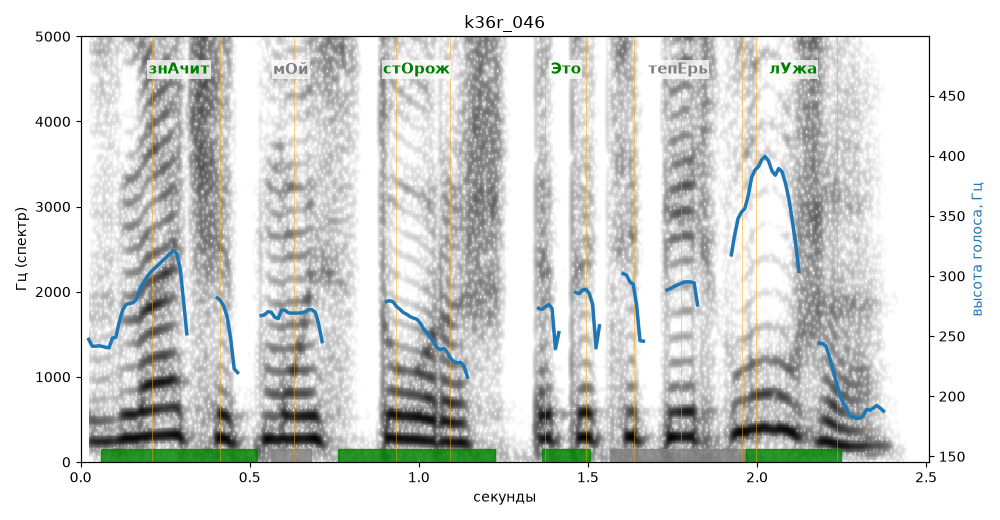

# k36r_046

Голос: **Рон, сборка 36e** · длительность 2.5 с
Эталон: Значит, мой сторож — это теперь лужа?
Распознано: Значит, мой сторож, это теперь лужа?
Слова: все совпали

## Ударения
(где нужно: ruaccent)

| слово | нужно | у голоса | |
|---|---|---|---|
| значит | знАчит | знАчит | ✓ |
| сторож | стОрож | стОрож | ✓ |
| это | Это | Это | ✓ |
| теперь | тепЕрь | — | ? |
| лужа | лУжа | лУжа | ✓ |

## Интонация
- ✓ «значит мой сторож это теперь лужа?» — вопросительный подъём на слове «лужа»
- Диапазон голоса 12.2 полутонов (живо), средняя высота 272 Гц

## Паузы и темп
- после «значит,» нет паузы (0.04 с)
- Темп 5.5 слога/с (нормально)

_Синяя линия — высота голоса. Над словами заглавная буква — где ударение должно быть; красным — голос поставил не туда (уверенно), оранжевым — возможно._
