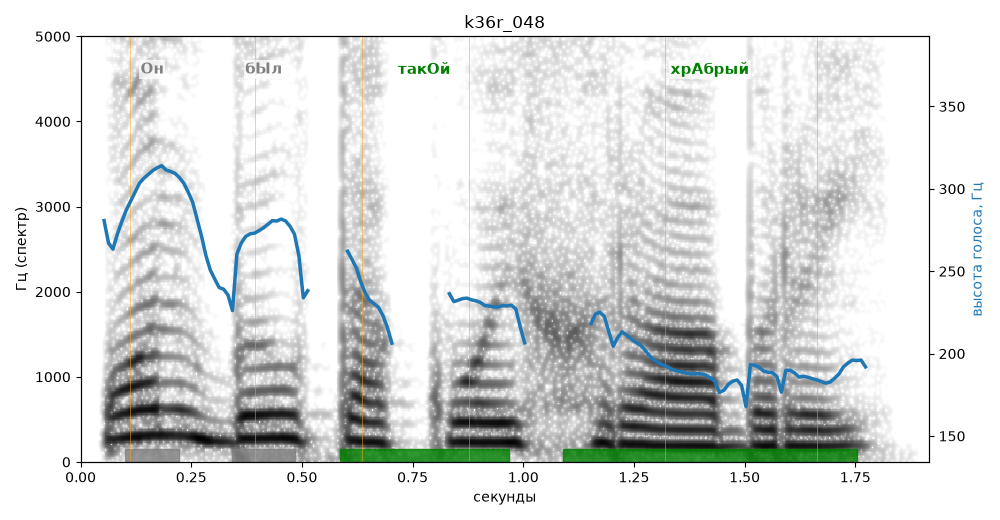

# k36r_048

Голос: **Рон, сборка 36e** · длительность 1.9 с
Эталон: Он был такой храбрый.
Распознано: Он был такой храбрый.
Слова: все совпали

## Ударения
(где нужно: ruaccent)

| слово | нужно | у голоса | |
|---|---|---|---|
| такой | такОй | такОй | ✓ |
| храбрый | хрАбрый | хрАбрый | ✓ |

## Интонация
- ✓ «он был такой храбрый.» — конец фразы понижается — звучит законченно
- Диапазон голоса 9.0 полутонов (живо), средняя высота 227 Гц

## Паузы и темп
- паузы на своих местах
- Темп 3.6 слога/с (медленно)

_Синяя линия — высота голоса. Над словами заглавная буква — где ударение должно быть; красным — голос поставил не туда (уверенно), оранжевым — возможно._
