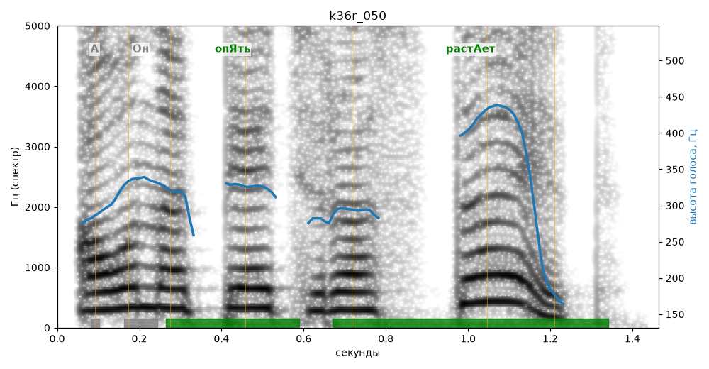

# k36r_050

Голос: **Рон, сборка 36e** · длительность 1.5 с
Эталон: А он опять растает?
Распознано: А он опять растает!
Слова: все совпали

## Ударения
(где нужно: ruaccent)

| слово | нужно | у голоса | |
|---|---|---|---|
| опять | опЯть | опЯть | ✓ |
| растает | растАет | растАет | ✓ |

## Интонация
- ✓ «а он опять растает?» — вопросительный подъём на слове «растает»
- Диапазон голоса 13.6 полутонов (живо), средняя высота 319 Гц

## Паузы и темп
- паузы на своих местах
- Темп 5.6 слога/с (нормально)

_Синяя линия — высота голоса. Над словами заглавная буква — где ударение должно быть; красным — голос поставил не туда (уверенно), оранжевым — возможно._
