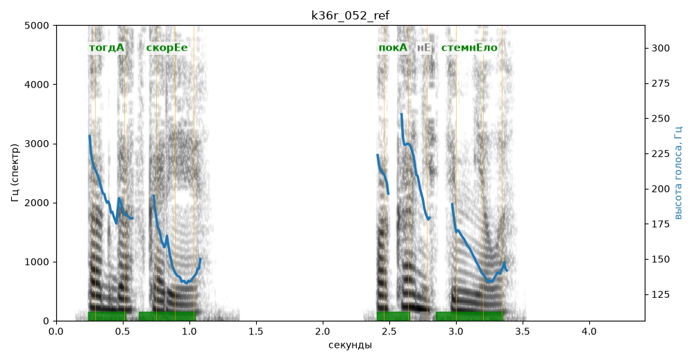

# k36r_052_ref

Голос: **edge:ru-RU-SvetlanaNeural** · длительность 4.4 с
Эталон: Тогда скорее! Пока не стемнело!
Распознано: тогда скорее пока не стемнело
Слова: все совпали

## Ударения
(где нужно: ruaccent)

| слово | нужно | у голоса | |
|---|---|---|---|
| тогда | тогдА | тогдА | ✓ |
| скорее | скорЕе | скорЕе | ✓ |
| пока | покА | покА | ✓ |
| стемнело | стемнЕло | стемнЕло | ✓ |

## Интонация
- ✗ «тогда скорее!» — восклицание звучит ровно, без эмоции
- ✓ «пока не стемнело!» — выделено слово «пока» (+4.5 пт)
- Диапазон голоса 9.4 полутонов (живо), средняя высота 172 Гц

## Паузы и темп
- паузы на своих местах
- Темп 6.3 слога/с (нормально)

_Синяя линия — высота голоса. Над словами заглавная буква — где ударение должно быть; красным — голос поставил не туда (уверенно), оранжевым — возможно._
