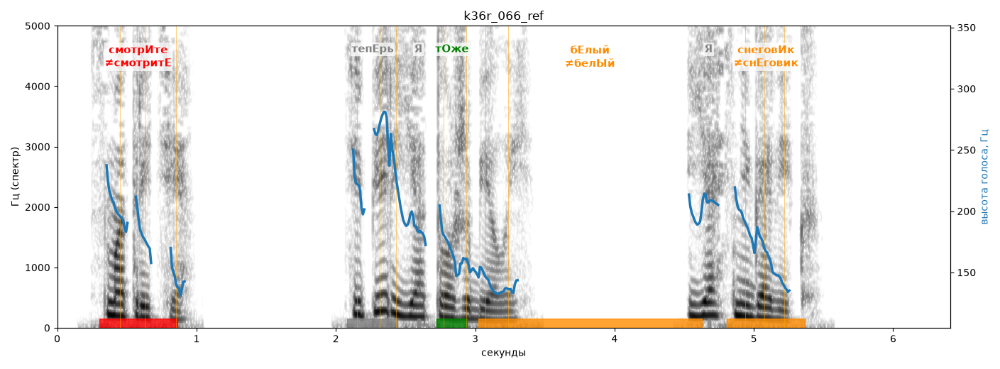

# k36r_066_ref

Голос: **edge:ru-RU-SvetlanaNeural** · длительность 6.4 с
Эталон: Смотри́те! Теперь я тоже белый! Я снеговик!
Распознано: Смотрите. Теперь я тоже белый. Я снеговик.
Расхождения в словах: «смотри те» → «смотрите»

## Ударения
(где нужно: ruaccent)

| слово | нужно | у голоса | |
|---|---|---|---|
| смотрите | смотрИте | смотритЕ | ✗ ОШИБКА |
| теперь | тепЕрь | — | ? |
| тоже | тОже | тОже | ✓ |
| белый | бЕлый | белЫй | ✗? возможно — послушать |
| снеговик | снеговИк | снЕговик | ✗? возможно — послушать |

## Интонация
- ✗ «смотрите!» — восклицание звучит ровно, без эмоции
- ✓ «теперь я тоже белый!» — выделено слово «теперь» (+7.5 пт)
- ✗ «я снеговик!» — восклицание звучит ровно, без эмоции
- Диапазон голоса 11.5 полутонов (живо), средняя высота 182 Гц

## Паузы и темп
- после «белый!» пауза всего 0.04 с — фразы слипаются
- Темп 3.4 слога/с (медленно)

_Синяя линия — высота голоса. Над словами заглавная буква — где ударение должно быть; красным — голос поставил не туда (уверенно), оранжевым — возможно._
