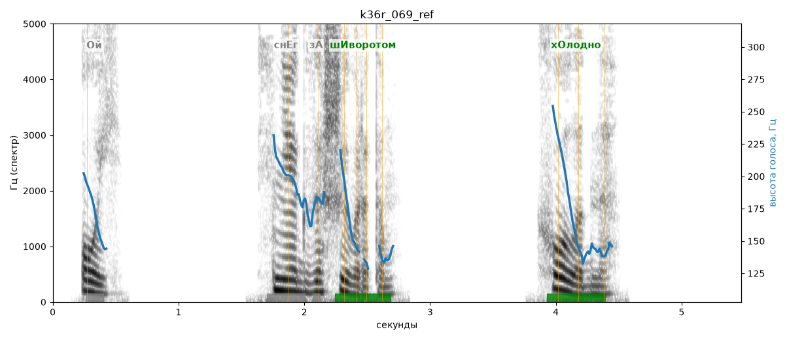

# k36r_069_ref

Голос: **edge:ru-RU-SvetlanaNeural** · длительность 5.5 с
Эталон: Ой. Снег за шиворотом. Холодно!
Распознано: Ой! Сняк зашив ротом! Холодно!
Расхождения в словах: «снег за шиворотом» → «сняк зашив ротом»

## Ударения
(где нужно: ruaccent)

| слово | нужно | у голоса | |
|---|---|---|---|
| шиворотом | шИворотом | шИворотом | ✓ |
| холодно | хОлодно | хОлодно | ✓ |

## Интонация
- ✗ «снег за шиворотом.» — конец фразы не понижается — звучит незаконченно / как перечисление
- ✓ «холодно!» — выделено слово «холодно» (+7.6 пт)
- Диапазон голоса 8.6 полутонов (живо), средняя высота 170 Гц

## Паузы и темп
- паузы на своих местах
- Темп 6.3 слога/с (нормально)

_Синяя линия — высота голоса. Над словами заглавная буква — где ударение должно быть; красным — голос поставил не туда (уверенно), оранжевым — возможно._
