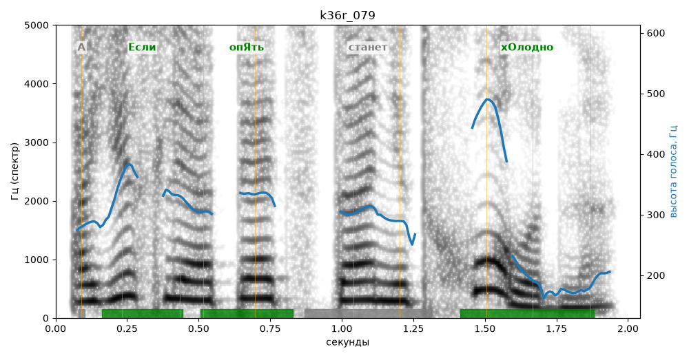

# k36r_079

Голос: **Рон, сборка 36e** · длительность 2.0 с
Эталон: А если опять станет холодно?
Распознано: А если опять станет холодно?
Слова: все совпали

## Ударения
(где нужно: ruaccent)

| слово | нужно | у голоса | |
|---|---|---|---|
| если | Если | Если | ✓ |
| опять | опЯть | опЯть | ✓ |
| станет | станет | стАнет | нет эталона |
| холодно | хОлодно | хОлодно | ✓ |

## Интонация
- ✓ «а если опять станет холодно?» — вопросительный подъём на слове «холодно»
- Диапазон голоса 17.2 полутонов (живо), средняя высота 301 Гц

## Паузы и темп
- паузы на своих местах
- Темп 5.6 слога/с (нормально)

_Синяя линия — высота голоса. Над словами заглавная буква — где ударение должно быть; красным — голос поставил не туда (уверенно), оранжевым — возможно._
