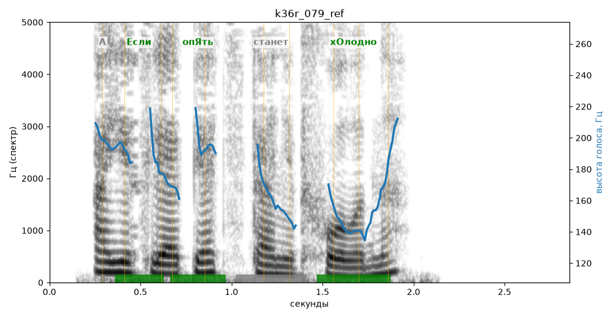

# k36r_079_ref

Голос: **edge:ru-RU-SvetlanaNeural** · длительность 2.9 с
Эталон: А если опять станет холодно?
Распознано: А если опять станет холодно?
Слова: все совпали

## Ударения
(где нужно: ruaccent)

| слово | нужно | у голоса | |
|---|---|---|---|
| если | Если | Если | ✓ |
| опять | опЯть | опЯть | ✓ |
| станет | станет | стАнет | нет эталона |
| холодно | хОлодно | хОлодно | ✓ |

## Интонация
- ✗ «а если опять станет холодно?» — нет вопросительного подъёма (самое высокое место — «а», в начале) — звучит как утверждение
- Диапазон голоса 6.8 полутонов (нормально), средняя высота 170 Гц

## Паузы и темп
- паузы на своих местах
- Темп 6.3 слога/с (нормально)

_Синяя линия — высота голоса. Над словами заглавная буква — где ударение должно быть; красным — голос поставил не туда (уверенно), оранжевым — возможно._
