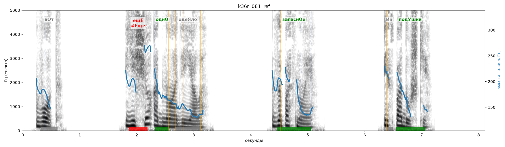

# k36r_081_ref

Голос: **edge:ru-RU-SvetlanaNeural** · длительность 8.1 с
Эталон: Вот! Ещё одно одеяло. Запасное. Из подушки.
Распознано: Вот. Еще одно одеяло. Запасное. Из подушки.
Слова: все совпали

## Ударения
(где нужно: ruaccent)

| слово | нужно | у голоса | |
|---|---|---|---|
| ещё | ещЁ | Ещё | ✗ ОШИБКА |
| одно | однО | однО | ✓ |
| одеяло | одеЯло | — | ? |
| запасное | запаснОе | запаснОе | ✓ |
| подушки | подУшки | подУшки | ✓ |

## Интонация
- ✓ «ещё одно одеяло.» — конец фразы понижается — звучит законченно
- ✓ «запасное.» — конец фразы понижается — звучит законченно
- ✓ «из подушки.» — конец фразы понижается — звучит законченно
- Диапазон голоса 9.3 полутонов (живо), средняя высота 171 Гц

## Паузы и темп
- паузы на своих местах
- Темп 5.7 слога/с (нормально)

_Синяя линия — высота голоса. Над словами заглавная буква — где ударение должно быть; красным — голос поставил не туда (уверенно), оранжевым — возможно._
