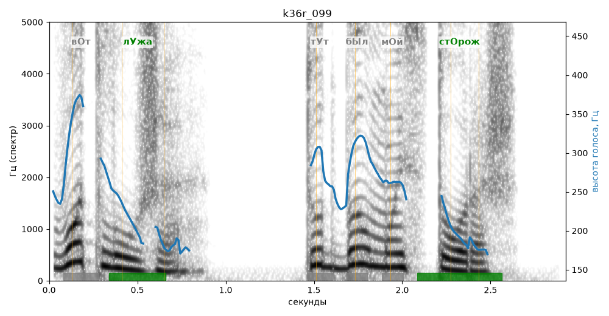

# k36r_099

Голос: **Рон, сборка 36e** · длительность 2.9 с
Эталон: Вот лужа. Тут был мой сторож.
Распознано: Вот лужа. Тут был мой сторож.
Слова: все совпали

## Ударения
(где нужно: ruaccent)

| слово | нужно | у голоса | |
|---|---|---|---|
| лужа | лУжа | лУжа | ✓ |
| сторож | стОрож | стОрож | ✓ |

## Интонация
- ✗ «вот лужа.» — конец фразы не понижается — звучит незаконченно / как перечисление
- ✓ «тут был мой сторож.» — конец фразы понижается — звучит законченно
- Диапазон голоса 11.2 полутонов (живо), средняя высота 244 Гц

## Паузы и темп
- паузы на своих местах
- Темп 4.8 слога/с (нормально)

_Синяя линия — высота голоса. Над словами заглавная буква — где ударение должно быть; красным — голос поставил не туда (уверенно), оранжевым — возможно._
