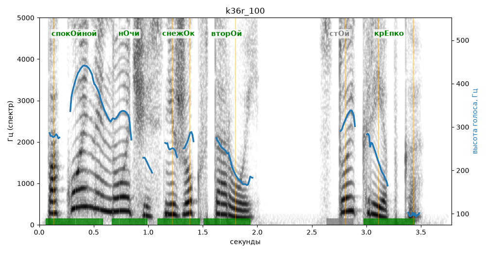

# k36r_100

Голос: **Рон, сборка 36e** · длительность 3.8 с
Эталон: Спокойной ночи, Снежок Второй. Стой крепко.
Распознано: Покойный ночи снежок второй. Стой крепко.
Расхождения в словах: «спокойной» → «покойный»

## Ударения
(где нужно: ruaccent)

| слово | нужно | у голоса | |
|---|---|---|---|
| спокойной | спокОйной | спокОйной | ✓ |
| ночи | нОчи | нОчи | ✓ |
| снежок | снежОк | снежОк | ✓ |
| второй | вторОй | вторОй | ✓ |
| крепко | крЕпко | крЕпко | ✓ |

## Интонация
- ✓ «спокойной ночи снежок второй.» — конец фразы понижается — звучит законченно
- ✗ «стой крепко.» — конец фразы не понижается — звучит незаконченно / как перечисление
- Диапазон голоса 24.9 полутонов (живо), средняя высота 271 Гц

## Паузы и темп
- паузы на своих местах
- Темп 4.5 слога/с (нормально)

_Синяя линия — высота голоса. Над словами заглавная буква — где ударение должно быть; красным — голос поставил не туда (уверенно), оранжевым — возможно._
