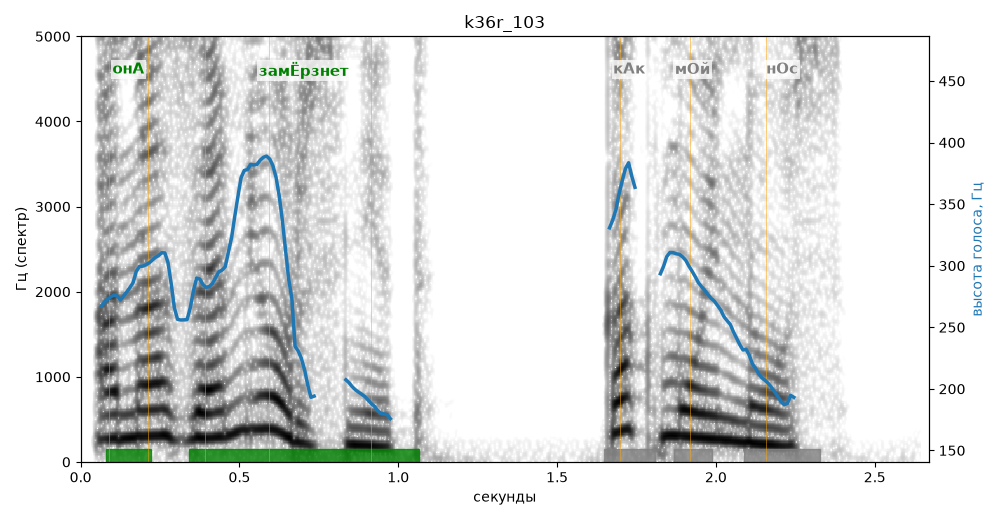

# k36r_103

Голос: **Рон, сборка 36e** · длительность 2.7 с
Эталон: Она замёрзнет? Как мой нос?
Распознано: Она замёрзнет. Как мой нос?
Слова: все совпали

## Ударения
(где нужно: ruaccent)

| слово | нужно | у голоса | |
|---|---|---|---|
| она | онА | онА | ✓ |
| замёрзнет | замЁрзнет | замЁрзнет | ✓ |

## Интонация
- ✓ «она замёрзнет?» — вопросительный подъём на слове «замёрзнет»
- ✓ «как мой нос?» — конец фразы понижается — звучит законченно
- Диапазон голоса 12.3 полутонов (живо), средняя высота 280 Гц

## Паузы и темп
- паузы на своих местах
- Темп 4.8 слога/с (нормально)

_Синяя линия — высота голоса. Над словами заглавная буква — где ударение должно быть; красным — голос поставил не туда (уверенно), оранжевым — возможно._
