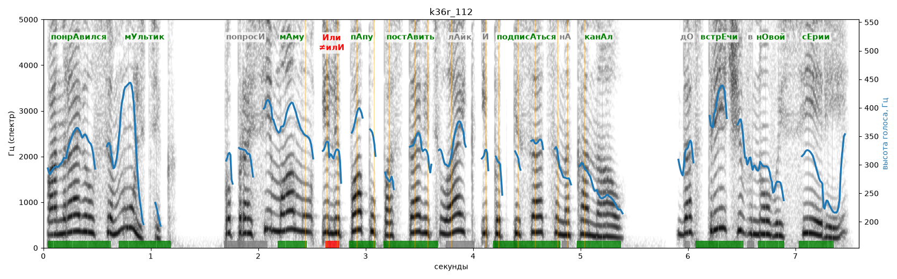

# k36r_112

Голос: **Рон, сборка 36e** · длительность 7.6 с
Эталон: Понравился мультик? Попроси маму или папу поставить лайк и подписаться на канал. До встречи в новой серии!
Распознано: Понравился мультик? Попроси маму или папу поставить лайк и подписаться на канал. До встречи в новой серии!
Слова: все совпали

## Ударения
(где нужно: ruaccent)

| слово | нужно | у голоса | |
|---|---|---|---|
| понравился | понрАвился | понрАвился | ✓ |
| мультик | мУльтик | мУльтик | ✓ |
| попроси | попросИ | попрОси | ? не разобрать |
| маму | мАму | мАму | ✓ |
| или | Или | илИ | ✗ ОШИБКА |
| папу | пАпу | пАпу | ✓ |
| поставить | постАвить | постАвить | ✓ |
| подписаться | подписАться | подписАться | ✓ |
| канал | канАл | канАл | ✓ |
| встречи | встрЕчи | встрЕчи | ✓ |
| новой | нОвой | нОвой | ✓ |
| серии | сЕрии | сЕрии | ✓ |

## Интонация
- ✓ «понравился мультик?» — вопросительный подъём на слове «мультик»
- ✓ «попроси маму или папу поставить лайк и подписаться на канал.» — конец фразы понижается — звучит законченно
- ✓ «до встречи в новой серии!» — выделено слово «встречи» (+5.4 пт)
- Диапазон голоса 10.2 полутонов (живо), средняя высота 319 Гц

## Паузы и темп
- паузы на своих местах
- Темп 6.0 слога/с (нормально)

_Синяя линия — высота голоса. Над словами заглавная буква — где ударение должно быть; красным — голос поставил не туда (уверенно), оранжевым — возможно._
