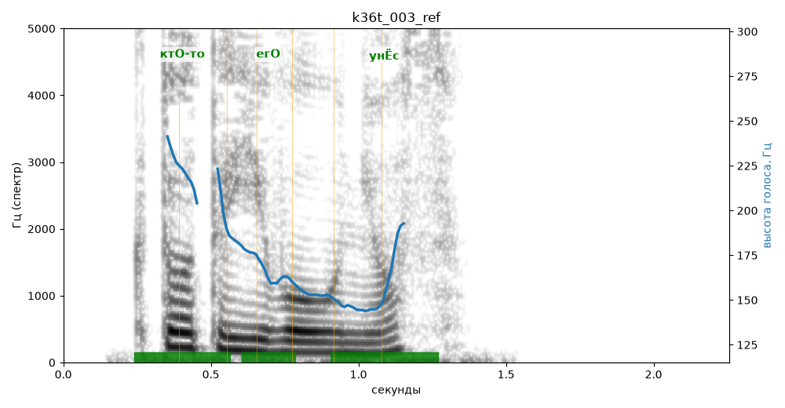

# k36t_003_ref

Голос: **edge:ru-RU-SvetlanaNeural** · длительность 2.3 с
Эталон: Кто-то его унёс?
Распознано: Кто ты его унес?
Расхождения в словах: «кто-то» → «кто ты»

## Ударения
(где нужно: ruaccent)

| слово | нужно | у голоса | |
|---|---|---|---|
| кто-то | ктО-то | ктО-то | ✓ |
| его | егО | егО | ✓ |
| унёс | унЁс | унЁс | ✓ |

## Интонация
- ✗ «кто-то его унёс?» — нет вопросительного подъёма (самое высокое место — «кто-то», в начале) — звучит как утверждение
- Диапазон голоса 7.7 полутонов (живо), средняя высота 162 Гц

## Паузы и темп
- паузы на своих местах
- Темп 5.8 слога/с (нормально)

_Синяя линия — высота голоса. Над словами заглавная буква — где ударение должно быть; красным — голос поставил не туда (уверенно), оранжевым — возможно._
