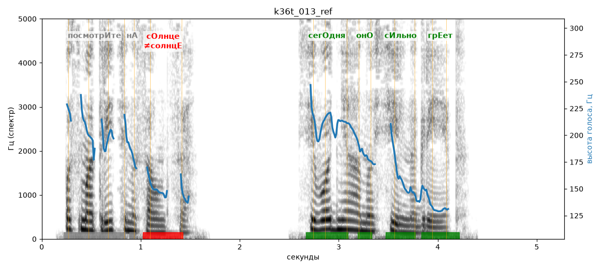

# k36t_013_ref

Голос: **edge:ru-RU-SvetlanaNeural** · длительность 5.3 с
Эталон: Посмотрите на со́лнце. Сегодня оно́ сильно гре́ет.
Распознано: Посмотрите на солнце. Сегодня оно сильно греет.
Расхождения в словах: «со лнце» → «солнце»; «гре ет» → «греет»

## Ударения
(где нужно: ruaccent)

| слово | нужно | у голоса | |
|---|---|---|---|
| посмотрите | посмотрИте | пОсмотрите | ? не разобрать |
| солнце | сОлнце | солнцЕ | ✗ ОШИБКА |
| сегодня | сегОдня | сегОдня | ✓ |
| оно | онО | онО | ✓ |
| сильно | сИльно | сИльно | ✓ |
| греет | грЕет | грЕет | ✓ |

## Интонация
- ✓ «посмотрите на солнце.» — конец фразы понижается — звучит законченно
- ✓ «сегодня оно сильно греет.» — конец фразы понижается — звучит законченно
- Диапазон голоса 9.0 полутонов (живо), средняя высота 182 Гц

## Паузы и темп
- паузы на своих местах
- Темп 5.8 слога/с (нормально)

_Синяя линия — высота голоса. Над словами заглавная буква — где ударение должно быть; красным — голос поставил не туда (уверенно), оранжевым — возможно._
