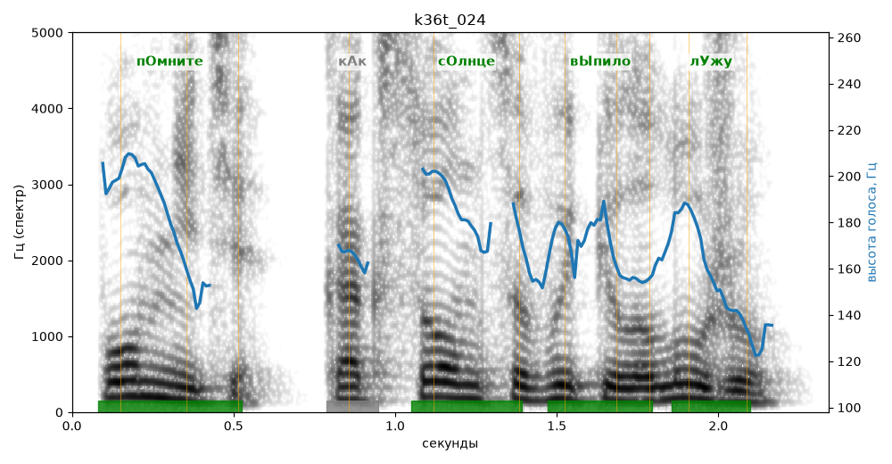

# k36t_024

Голос: **Топа, сборка 36e** · длительность 2.3 с
Эталон: Помните, как солнце выпило лужу?
Распознано: Помните, как солнце выпила лужу?
Расхождения в словах: «выпило» → «выпила»

## Ударения
(где нужно: ruaccent)

| слово | нужно | у голоса | |
|---|---|---|---|
| помните | пОмните | пОмните | ✓ |
| солнце | сОлнце | сОлнце | ✓ |
| выпило | вЫпило | вЫпило | ✓ |
| лужу | лУжу | лУжу | ✓ |

## Интонация
- ✗ «помните как солнце выпило лужу?» — нет вопросительного подъёма (самое высокое место — «помните», в начале) — звучит как утверждение
- Диапазон голоса 7.1 полутонов (живо), средняя высота 170 Гц

## Паузы и темп
- паузы на своих местах
- Темп 6.3 слога/с (нормально)

_Синяя линия — высота голоса. Над словами заглавная буква — где ударение должно быть; красным — голос поставил не туда (уверенно), оранжевым — возможно._
