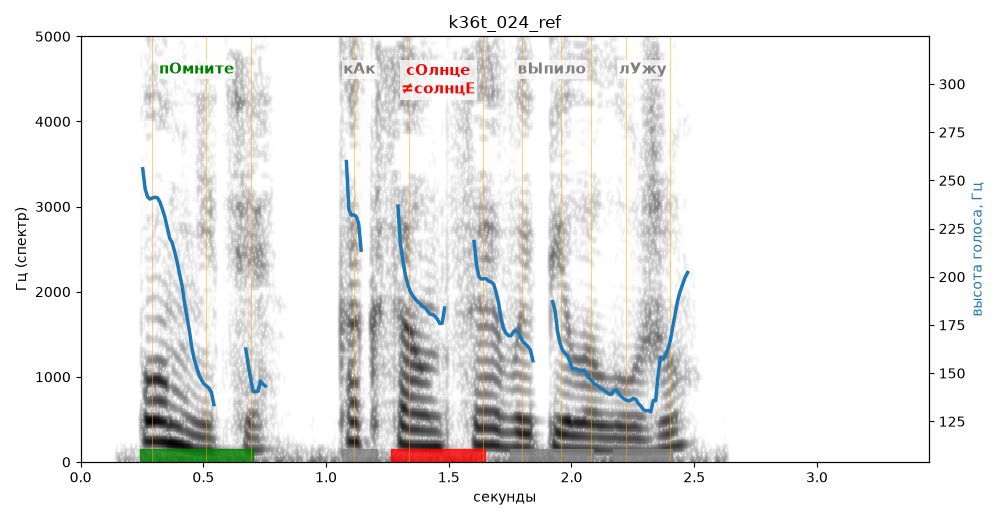

# k36t_024_ref

Голос: **edge:ru-RU-SvetlanaNeural** · длительность 3.5 с
Эталон: Помните, как со́лнце вы́пило лужу?
Распознано: Помните, как Саунцэ выпила лужу?
Расхождения в словах: «со лнце вы пило» → «саунцэ выпила»

## Ударения
(где нужно: ruaccent)

| слово | нужно | у голоса | |
|---|---|---|---|
| помните | пОмните | пОмните | ✓ |
| солнце | сОлнце | солнцЕ | ✗ ОШИБКА |
| выпило | вЫпило | выпИло | ? не разобрать |
| лужу | лУжу | лужУ | ? не разобрать |

## Интонация
- ✗ «помните как солнце выпило лужу?» — нет вопросительного подъёма (самое высокое место — «помните», в начале) — звучит как утверждение
- Диапазон голоса 9.9 полутонов (живо), средняя высота 171 Гц

## Паузы и темп
- паузы на своих местах
- Темп 6.1 слога/с (нормально)

_Синяя линия — высота голоса. Над словами заглавная буква — где ударение должно быть; красным — голос поставил не туда (уверенно), оранжевым — возможно._
