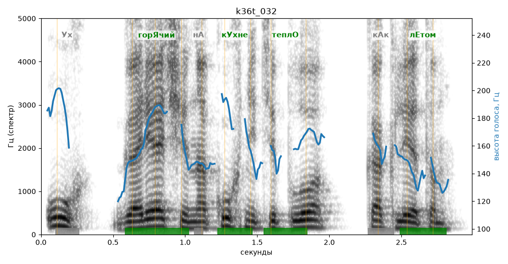

# k36t_032

Голос: **Топа, сборка 36e** · длительность 3.0 с
Эталон: Ух, горячий! На кухне тепло, как летом.
Распознано: Ух, горячий на кухне тепло, как летом.
Слова: все совпали

## Ударения
(где нужно: ruaccent)

| слово | нужно | у голоса | |
|---|---|---|---|
| горячий | горЯчий | горЯчий | ✓ |
| кухне | кУхне | кУхне | ✓ |
| тепло | теплО | теплО | ✓ |
| летом | лЕтом | лЕтом | ✓ |

## Интонация
- ✓ «ух горячий!» — выделено слово «ух» (+2.1 пт)
- ✗ «на кухне тепло как летом.» — конец фразы не понижается — звучит незаконченно / как перечисление
- Диапазон голоса 7.0 полутонов (живо), средняя высота 156 Гц

## Паузы и темп
- после «горячий!» пауза всего 0.04 с — фразы слипаются
- Темп 6.1 слога/с (нормально)

_Синяя линия — высота голоса. Над словами заглавная буква — где ударение должно быть; красным — голос поставил не туда (уверенно), оранжевым — возможно._
