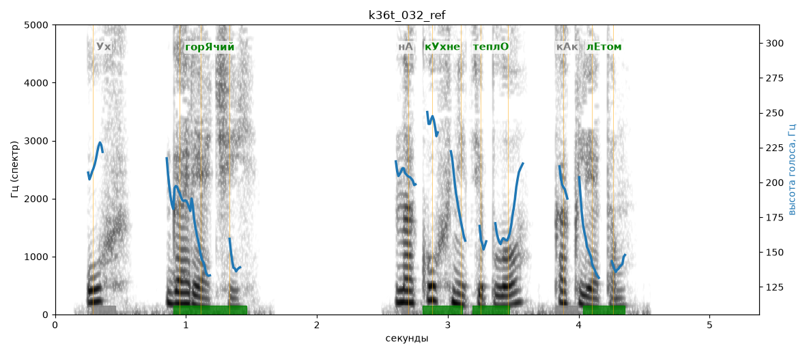

# k36t_032_ref

Голос: **edge:ru-RU-SvetlanaNeural** · длительность 5.4 с
Эталон: Ух, горячий! На кухне тепло, как летом.
Распознано: Ух, горячий. На кухне тепло, как летом.
Слова: все совпали

## Ударения
(где нужно: ruaccent)

| слово | нужно | у голоса | |
|---|---|---|---|
| горячий | горЯчий | горЯчий | ✓ |
| кухне | кУхне | кУхне | ✓ |
| тепло | теплО | теплО | ✓ |
| летом | лЕтом | лЕтом | ✓ |

## Интонация
- ✓ «ух горячий!» — выделено слово «ух» (+4.3 пт)
- ✓ «на кухне тепло как летом.» — конец фразы понижается — звучит законченно
- Диапазон голоса 9.4 полутонов (живо), средняя высота 182 Гц

## Паузы и темп
- паузы на своих местах
- Темп 5.8 слога/с (нормально)

_Синяя линия — высота голоса. Над словами заглавная буква — где ударение должно быть; красным — голос поставил не туда (уверенно), оранжевым — возможно._
