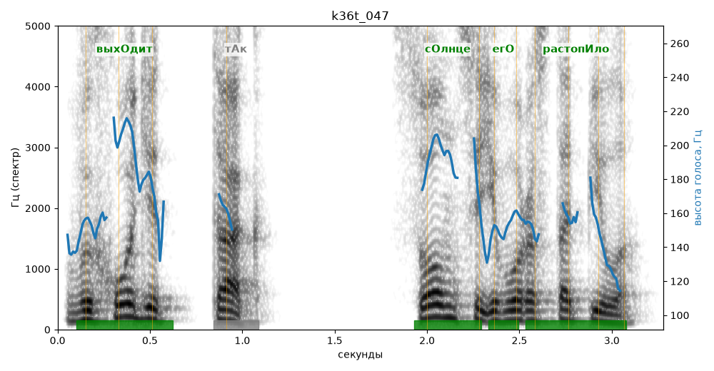

# k36t_047

Голос: **Топа, сборка 36e** · длительность 3.3 с
Эталон: Выходит, так. Солнце его растопило.
Распознано: Выходит так. Солнце его растопило.
Слова: все совпали

## Ударения
(где нужно: ruaccent)

| слово | нужно | у голоса | |
|---|---|---|---|
| выходит | выхОдит | выхОдит | ✓ |
| солнце | сОлнце | сОлнце | ✓ |
| его | егО | егО | ✓ |
| растопило | растопИло | растопИло | ✓ |

## Интонация
- ✓ «выходит так.» — конец фразы понижается — звучит законченно
- ✓ «солнце его растопило.» — конец фразы понижается — звучит законченно
- Диапазон голоса 8.1 полутонов (живо), средняя высота 158 Гц

## Паузы и темп
- паузы на своих местах
- Темп 6.3 слога/с (нормально)

_Синяя линия — высота голоса. Над словами заглавная буква — где ударение должно быть; красным — голос поставил не туда (уверенно), оранжевым — возможно._
