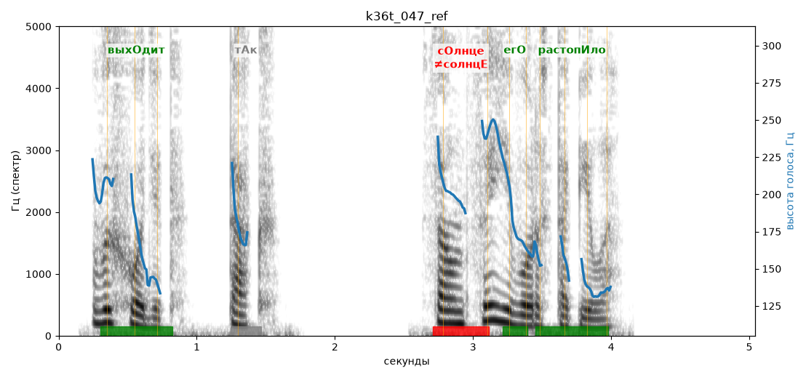

# k36t_047_ref

Голос: **edge:ru-RU-SvetlanaNeural** · длительность 5.0 с
Эталон: Выходит, так. Со́лнце его растопило.
Распознано: Выходит, так. Солнце его растопило.
Расхождения в словах: «со лнце» → «солнце»

## Ударения
(где нужно: ruaccent)

| слово | нужно | у голоса | |
|---|---|---|---|
| выходит | выхОдит | выхОдит | ✓ |
| солнце | сОлнце | солнцЕ | ✗ ОШИБКА |
| его | егО | егО | ✓ |
| растопило | растопИло | растопИло | ✓ |

## Интонация
- ✗ «выходит так.» — конец фразы не понижается — звучит незаконченно / как перечисление
- ✓ «солнце его растопило.» — конец фразы понижается — звучит законченно
- Диапазон голоса 10.3 полутонов (живо), средняя высота 175 Гц

## Паузы и темп
- паузы на своих местах
- Темп 6.0 слога/с (нормально)

_Синяя линия — высота голоса. Над словами заглавная буква — где ударение должно быть; красным — голос поставил не туда (уверенно), оранжевым — возможно._
