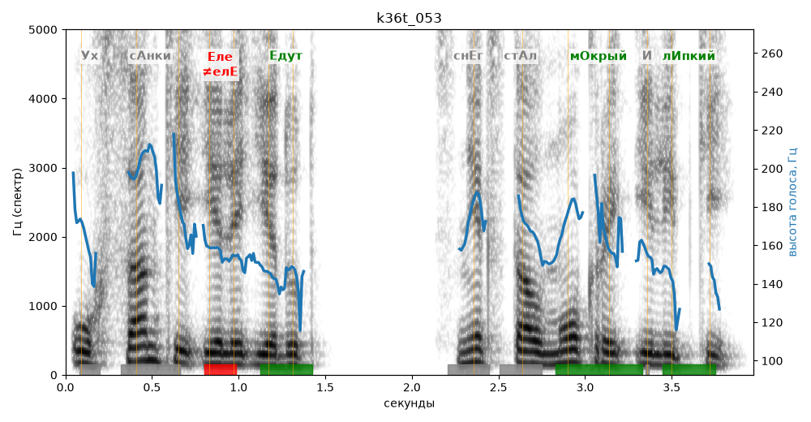

# k36t_053

Голос: **Топа, сборка 36e** · длительность 4.0 с
Эталон: Ух! Санки еле едут. Снег стал мокрый и липкий.
Распознано: Ух санки или едут. Снег стал мокрый и лепкий.
Расхождения в словах: «еле» → «или»; «липкий» → «лепкий»

## Ударения
(где нужно: ruaccent)

| слово | нужно | у голоса | |
|---|---|---|---|
| санки | сАнки | санкИ | ? не разобрать |
| еле | Еле | елЕ | ✗ ОШИБКА |
| едут | Едут | Едут | ✓ |
| мокрый | мОкрый | мОкрый | ✓ |
| липкий | лИпкий | лИпкий | ✓ |

## Интонация
- ✓ «санки еле едут.» — конец фразы понижается — звучит законченно
- ✓ «снег стал мокрый и липкий.» — конец фразы понижается — звучит законченно
- Диапазон голоса 6.5 полутонов (нормально), средняя высота 159 Гц

## Паузы и темп
- после «ух!» пауза всего 0.12 с — фразы слипаются
- Темп 4.8 слога/с (нормально)

_Синяя линия — высота голоса. Над словами заглавная буква — где ударение должно быть; красным — голос поставил не туда (уверенно), оранжевым — возможно._
